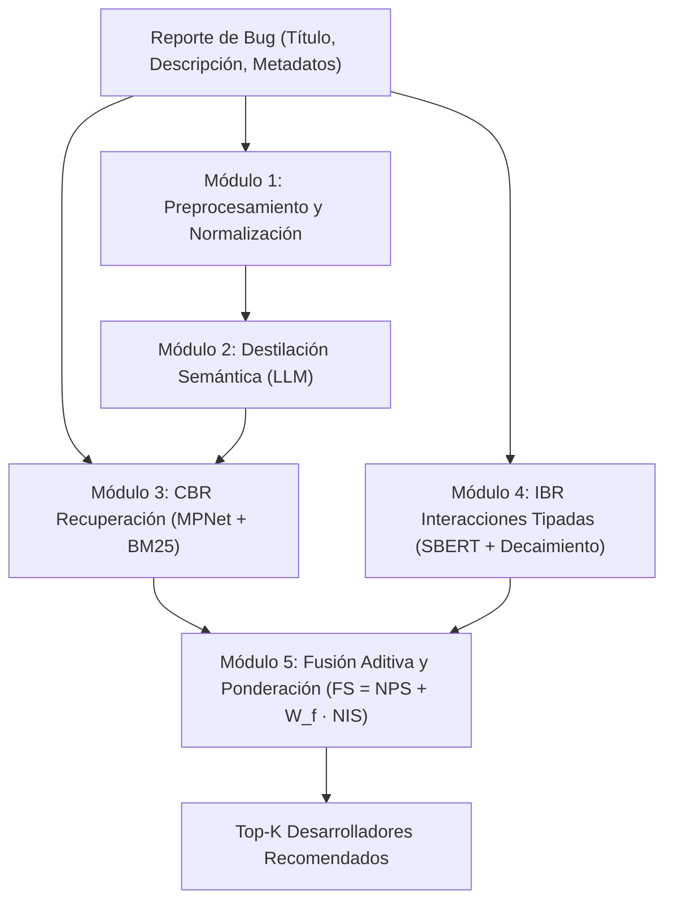

# Triager-Omega

> **Sistema híbrido de triaje y recomendación automática de desarrolladores para reportes de bugs**, combinando destilación semántica estructurada con LLM, razonamiento basado en casos (CBR de recuperación denso + léxico) y razonamiento basado en grafos de interacción temporal (IBR).

---

## 1. Arquitectura del Sistema

Triager-Omega opera sobre una arquitectura en cinco módulos diseñada para resolver los desafíos de **ruido textual**, **desbalance de clases por cola larga** y **dinámica temporal** en grandes repositorios de software (Mozilla Bugzilla, Eclipse OpenJ9, Microsoft TypeScript):



1. **Módulo 1 — Preprocesamiento y Normalización**: Curaduría de identidades, particionamiento temporal estricto (anti-fuga) y filtrado de desarrolladores activos.
2. **Módulo 2 — Destilación Semántica**: Compresión diagnóstica con LLMs (DeepSeek Flash / Gemma) que transforma reportes heterogéneos en una taxonomía canónica:
   - `[FL]` *Fault Location* (producto, subsistema, área de arquitectura).
   - `[SY]` *Symptoms* (comportamiento observable, logs, errores de compilación).
   - `[CP]` *Capabilities* (habilidades y herramientas de ingeniería requeridas para resolverlo).
3. **Módulo 3 — CBR de Recuperación (Case-Based Reasoning real)**:
   - Recuperación densa con Bi-Encoder (`all-mpnet-base-v2`) + léxica con BM25.
   - Fusión híbrida mediante *Reciprocal Rank Fusion* (RRF) y reordenamiento con Cross-Encoder.
   - Agregación de votos por desarrollador (`owner`) con ponderación anti-cola-larga (`idf`, `rank`, $\tau$).
4. **Módulo 4 — IBR (Interaction-Based Reasoning)**:
   - Minería de eventos en el ciclo de vida del software: commits, revisiones de código, asignaciones y discusiones.
   - Ponderación tipada (*Interaction Points*) con decaimiento exponencial temporal ($e^{-\lambda \Delta t}$).
5. **Módulo 5 — Agregación y Ranking**:
   - Fusión lineal $FS = NPS + W_f \cdot NIS$ con umbrales adaptativos (*gating*) y filtrado de candidatos activos.

---

## 2. Resultados Experimentales Frente al Estado del Arte

Evaluación head-to-head frente a **TriagerX** (publicado y re-ejecutado con rigor temporal):

| Dataset | Configuración | Top-1 (Hit@1) | Hit@5 | Hit@10 | MRR | Estado |
|---|---|---|---|---|---|---|
| **TypeScript** (40 clases) | TriagerX Paper (Ensemble 2 Transf. + 3 CNN) | 0.3240 | — | — | — | Baseline de literatura |
| **TypeScript** | **Triager-Omega (Distilled + Hybrid BM25+MPNet)** | **0.3354** | **0.6511** | **0.7740** | **0.4851** | **Nuevo récord (+1.14 pp)** |
| **OpenJ9** (50 clases) | TriagerX Paper (Re-ejecución) | 0.2810 | — | — | — | Baseline de literatura |
| **OpenJ9** | **Triager-Omega (Distilled + Hybrid CBR + IBR)** | **0.2940** | **0.5843** | **0.6854** | **0.4190** | **Nuevo récord (+1.30 pp)** |
| **Mozilla** (Piloto 20 devs) | Triager-Omega (Raw CBR + IBR Retuned) | **0.7337** | **0.9598** | **0.9876** | **0.8350** | Validado; corrida completa en curso |

---

## 3. Estructura del Repositorio

El proyecto se organiza en directorios desacoplados por función y dataset:

```text
triager-omega/
├── src/triager_omega/             # Core del sistema
│   ├── retrieval/                 # CBR de recuperación: CbrRetriever, voting, BM25, RRF
│   ├── modules/                   # ibr.py (interacciones) y aggregator.py (fusión)
│   ├── data/                      # loader.py, preprocessor.py, repo_miner.py
│   ├── cbr/                       # distillation.py y pilot.py (código de destilación y datos)
│   └── config.py                  # Configuración jerárquica y rutas dinámicas
│
├── scripts/                       # Utilidades de ejecución organizadas por etapa
│   ├── distill/                   # Pipelines de destilación DeepSeek/Ollama (TS y Python)
│   ├── benchmarks/                # Suites de evaluación por corpus
│   │   ├── openj9/                # build, sweep, eval OpenJ9 (50 clases)
│   │   ├── typescript/            # eval_ts_sweep.py, test_compare_single.ts
│   │   └── mozilla/               # cbr_retrieval_pilot.py, interacciones, EDA
│   ├── legacy/                    # Clasificadores DeBERTa y runners TriagerX archivados
│   ├── tools/                     # Scripts de validación de conexión a APIs
│   └── README.md                  # Catálogo detallado de scripts
│
├── docs/                          # Documentación formal y experimental
│   ├── tesis/                     # Capítulos 01 al 05 de la memoria y guion de presentación
│   ├── experimental/              # Reportes de benchmarks y barridos de hiperparámetros
│   ├── bitacoras/                 # Bitácoras de laboratorio y decisiones arquitectónicas
│   ├── schemas/                   # Schemas detallados de las fuentes de datos
│   └── README.md                  # Índice y sitemap de documentación
│
├── artifacts/                     # Salidas experimentales particionadas
│   ├── mozilla/                   # Splits, interacciones y piloto de Bugzilla
│   ├── openj9/                    # Datasets de 50 clases y destilaciones OpenJ9
│   ├── typescript/                # Embeddings MPNet y destilaciones TypeScript
│   ├── _archive/                  # Modelos DeBERTa supervisados descartados (1.4 GB)
│   └── README.md                  # Catálogo de artefactos
│
├── data/                          # Almacén de datasets parquet originales y curados
└── references/                    # Papers de referencia (TriagerX, etc.)
```

---

## 4. Guía Rápida de Ejecución

### Requisitos y Entorno
- Python `>=3.12, <3.13` gestionado con [`uv`](https://github.com/astral-sh/uv).
- Bun / Node para los scripts de destilación en TypeScript.
- Dispositivo acelerador: Apple Silicon (`mps`) o NVIDIA GPU (`cuda`).

```bash
# Sincronizar el entorno virtual
uv sync
```

### Reproducción de Benchmarks

```bash
# 1. Barrido de CBR en TypeScript (Dense vs Hybrid BM25+MPNet con voting idf):
uv run python scripts/benchmarks/typescript/eval_ts_sweep.py

# 2. Evaluación de CBR de recuperación en OpenJ9 (50 clases):
uv run python scripts/benchmarks/openj9/cbr_retrieval_openj9.py \
  --train-csv artifacts/openj9/openj9_train_50.csv \
  --test-csv artifacts/openj9/openj9_test_50.csv \
  --hybrid --sweep

# 3. Evaluación integral CBR + IBR en OpenJ9:
uv run python scripts/benchmarks/openj9/eval_openj9_full.py --cbr-mode retrieval

# 4. Evaluación del CBR en Mozilla (Piloto):
uv run python scripts/benchmarks/mozilla/cbr_retrieval_pilot.py --text-mode both --sweep
```

### Destilación Semántica con DeepSeek Flash

```bash
# Generar destilaciones de un split (ej. TypeScript):
bun run scripts/distill/distill_deepseek_ts.ts --csv artifacts/typescript/ts_train.csv
```

---

## 5. Tareas Pendientes

- [x] Marco teórico formal y diseño de la corrida oficial ([`docs/tesis/01-tesis-propuesta.md`](file:///Users/sebastian/Documents/Python/triager-omega/docs/tesis/01-tesis-propuesta.md)).
- [x] Implementación y retuning de Interaction Points en IBR ([`docs/tesis/04-comparativas.md`](file:///Users/sebastian/Documents/Python/triager-omega/docs/tesis/04-comparativas.md)).
- [x] Destilación y CBR híbrido en OpenJ9 (Récord 0.2940 Top-1).
- [x] Destilación y CBR híbrido en TypeScript (Récord 0.3354 Top-1).
- [ ] Destilación semántica especializada y evaluación CBR de recuperación en Mozilla Bugzilla (Hoja de ruta en [`docs/experimental/pendiente-evaluacion-mozilla.md`](file:///Users/sebastian/Documents/Python/triager-omega/docs/experimental/pendiente-evaluacion-mozilla.md)).
